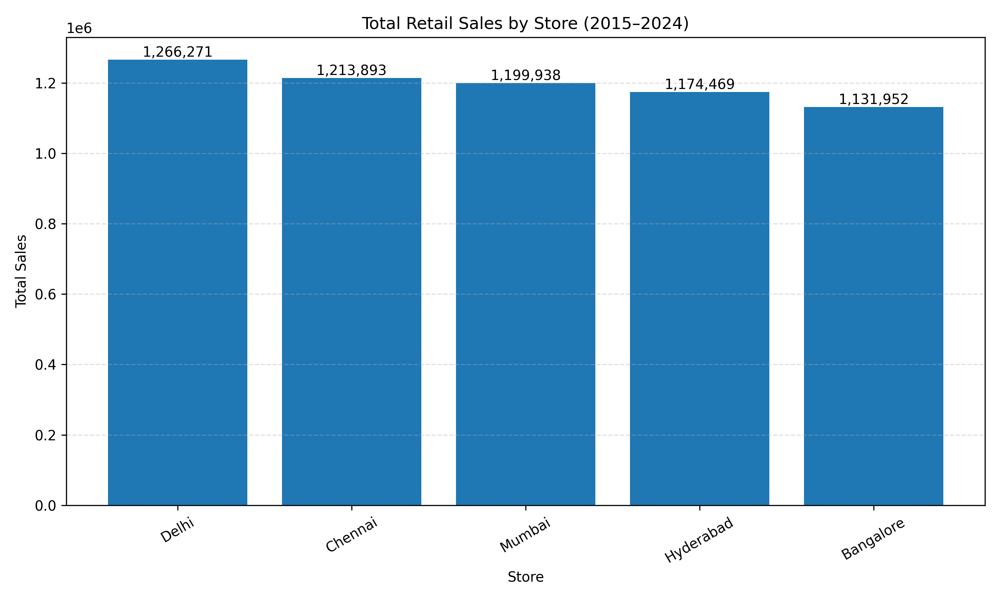
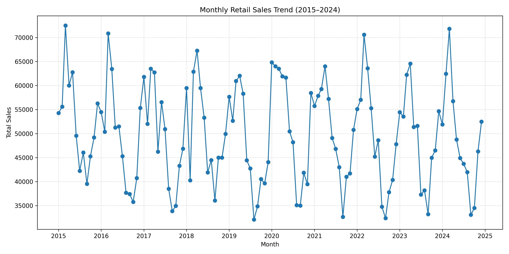
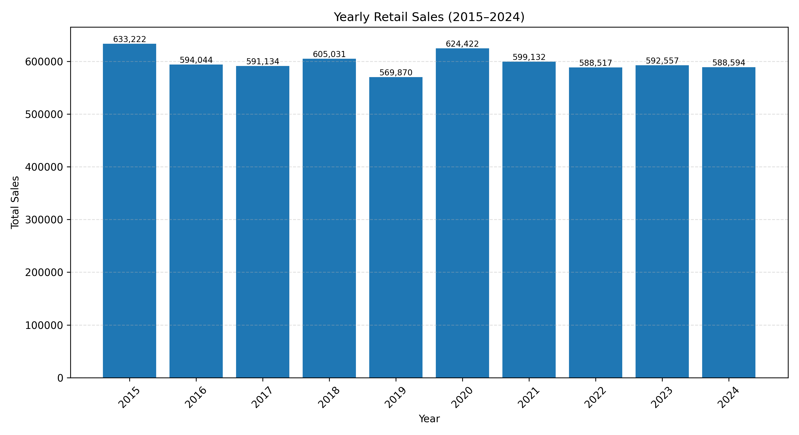
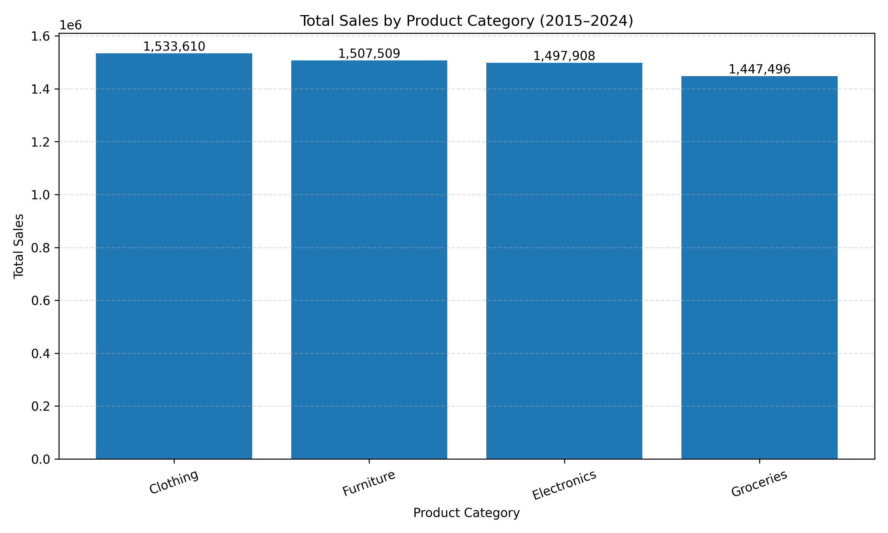

# Retail Sales Forecasting and Business Analytics

An end-to-end retail sales analysis and forecasting project using Python, Facebook Prophet, Pandas, Matplotlib, and Power BI.

This project analyses historical retail sales across multiple stores and product categories, identifies sales trends, and forecasts future monthly sales.

## Project Overview

The dataset contains 3,000 sales records covering January 2015 to December 2024.

**Dataset highlights:**
- 5 stores: Bangalore, Mumbai, Delhi, Hyderabad, and Chennai.
- 4 product categories: Electronics, Groceries, Clothing, and Furniture.
- Total recorded sales: 5,986,523.
- Average sales per record: 1,995.51.

## Technologies Used

- Python
- Pandas
- Matplotlib
- Facebook Prophet
- Scikit-learn
- Power BI

## Project Structure

```text
retail_sales_forecasting_repo/
│
├── data/
│   ├── retail_sales_data.csv
│   ├── monthly_total_for_prophet.csv
│   └── other prepared datasets
│
├── scripts/
│   ├── forecast_with_prophet.py
│   ├── store_sales_analysis.py
│   ├── monthly_sales_analysis.py
│   ├── yearly_sales_analysis.py
│   └── category_sales_analysis.py
│
├── reports/
│   ├── historical_monthly_sales.png
│   ├── store_sales_comparison.png
│   ├── monthly_sales_trend.png
│   ├── yearly_sales_trend.png
│   └── category_sales_comparison.png
│
├── powerbi/
├── docs/
├── requirements.txt
├── .gitignore
├── LICENSE
└── README
```

## Key Analysis and Findings

### 1. Store Sales Analysis

Delhi recorded the highest total sales, followed by Chennai, Mumbai, Hyderabad, and Bangalore.

### 2. Category Sales Analysis

Clothing recorded the highest total sales, followed by Furniture, Electronics, and Groceries.

### 3. Monthly Sales Analysis

Monthly sales were aggregated to identify changes and patterns over the 2015–2024 period.

### 4. Yearly Sales Analysis

Yearly sales were calculated to compare overall performance across different years.

## Visualizations

### Store Sales Comparison



### Monthly Sales Trend



### Yearly Sales Trend



### Category Sales Comparison



## Sales Forecasting

The project uses Facebook Prophet to forecast future monthly retail sales.

Run the forecasting script:

```bash
python scripts/forecast_with_prophet.py
```

The script generates:

- `performance.csv` – forecasting performance metrics.
- `forecast.csv` – predicted sales and uncertainty ranges.
- `forecast_plot.png` – historical sales and forecast visualization.

**Observed validation accuracy: 91.98%** on the last six months of the available data, as reported by the forecasting script. This is a historical validation result, not a guarantee of future accuracy.

## How to Run the Project

### 1. Clone the repository

```bash
git clone YOUR_GITHUB_REPOSITORY_URL
cd retail_sales_forecasting_repo
```

### 2. Create a virtual environment

```bash
python -m venv .venv
```

### 3. Activate the environment (Windows PowerShell)

```powershell
.venv\Scripts\Activate.ps1
```

### 4. Install dependencies

```bash
python -m pip install -r requirements.txt
```

### 5. Run the analysis scripts

```bash
python scripts/store_sales_analysis.py
python scripts/monthly_sales_analysis.py
python scripts/yearly_sales_analysis.py
python scripts/category_sales_analysis.py
```

### 6. Run the forecasting model

```bash
python scripts/forecast_with_prophet.py
```

## Power BI

The `powerbi/` folder contains a guide for creating a retail sales dashboard, including sales KPIs, trends, and store/category comparisons.

## Future Improvements

- Develop an interactive Streamlit dashboard.
- Compare multiple forecasting models.
- Add deeper store and category performance analysis.
- Improve forecast evaluation and visualization.
- Explore seasonal sales patterns.

## Dataset

The original project describes the supplied dataset as synthetic and intended for portfolio use.

## Attribution

This project builds upon the original work by [Nitish Anokola](https://github.com/nitishankola/Retail-Sales-Forecasting-).

Additional analysis scripts, visualizations, and documentation have been developed as part of this project.

Please see the LICENSE file for licensing terms.

## Author

**Your Name**

Retail Sales Forecasting and Business Analytics Project.
